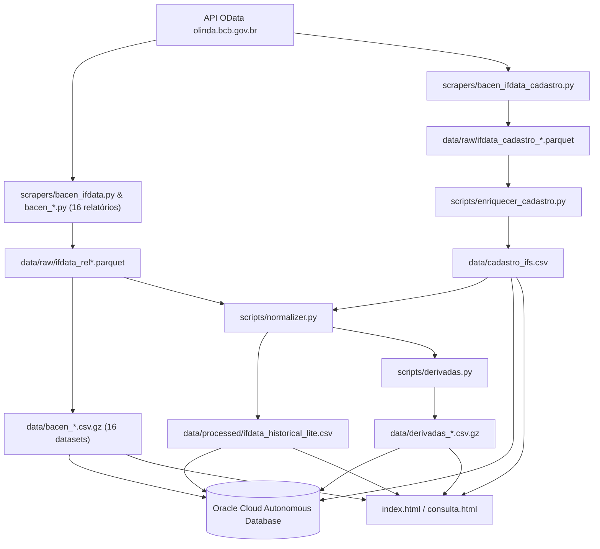

# PulseIFData

**Inteligência do Sistema Financeiro Nacional** — dados do IFData/BACEN estruturados, normalizados e entregues para uso institucional.

[](https://github.com/PulseDataLabs/PulseIFData/actions/workflows/main.yml)

---

## O problema

O IFData do BACEN é **público**, mas a experiência de uso é terrível:

- A API OData exige queries manuais por **relatório** × **trimestre** × **tipo de instituição**
- Sem série histórica consolidada — cada query retorna um trimestre isolado
- Paginação necessária para relatórios com muitos registros
- Quebras de série no plano COSIF (ex: mar/2025, com novos códigos `1401xx`/`1402xx`/`1418xx` e Relatório 16) que dificultam comparações históricas
- Endpoint `IfDataCadastro` retorna HTTP 500 se chamado com `$top`/`$skip` na primeira requisição, exigindo paginação adaptativa

O PulseIFData resolve isso: coleta todos os **16 relatórios oficiais do IFData** mais o **cadastro histórico completo de IFs**, normaliza e entrega tudo em schema fixo.

## Posicionamento no portfólio PulseDataLabs

| Produto | Cobre | Gap |
|---------|-------|-----|
| **PulseFlat** | Macro e mercado (taxas, câmbio, fundos, índices) | Não cobre instituições financeiras individuais |
| **PulseRatings** | Risco de crédito externo (S&P, Moody's, Fitch) | Não cobre o SFN doméstico |
| **PulseIFData** | Inteligência competitiva do SFN | **Complementar** — inadimplência, market share, crescimento por IF |

Cruzamento exclusivo: PulseIFData + PulseFlat (SELIC, CDI) → **NIM ajustado ao ciclo de juros**.

## Arquitetura

```
PulseIFData/
├── scrapers/
│   ├── utils/
│   │   ├── base.py                                    # BaseScraper (herdado do ecossistema)
│   │   ├── odata.py                                   # Paginação OData adaptativa, checkpointing, períodos
│   │   └── ifdata_relatorio.py                        # Base consolidada Polars p/ os 16 relatórios IFData
│   ├── bacen_ifdata.py                                # Scraper unificado de checkpoints IFData
│   ├── bacen_ifdata_cadastro.py                       # Scraper histórico de cadastro (IfDataCadastro 2014–hoje)
│   ├── bacen_resumo.py                                # Relatório 1 — Resumo
│   ├── bacen_ativo.py                                 # Relatório 2 — Ativo
│   ├── bacen_passivo.py                               # Relatório 3 — Passivo
│   ├── bacen_dre.py                                   # Relatório 4 — Demonstração de Resultado (DRE)
│   ├── bacen_informacoes_capital.py                   # Relatório 5 — Informações de Capital
│   ├── bacen_segmentacao.py                           # Relatório 6 — Segmentação Prudencial
│   ├── bacen_credito_indexador.py                     # Relatório 7 — Crédito por Indexador
│   ├── bacen_credito_nivel_risco.py                   # Relatório 8 — Crédito por Nível de Risco
│   ├── bacen_credito_regiao.py                        # Relatório 9 — Crédito por Região Geográfica
│   ├── bacen_credito_clientes_operacoes.py            # Relatório 10 — Crédito: Clientes e Operações
│   ├── bacen_credito_pf_modalidade_prazo.py           # Relatório 11 — Crédito PF: Modalidade e Prazo
│   ├── bacen_credito_pj_cnae.py                       # Relatório 12 — Crédito PJ: Atividade Econômica (CNAE)
│   ├── bacen_credito_pj_modalidade_prazo.py           # Relatório 13 — Crédito PJ: Modalidade e Prazo
│   ├── bacen_credito_pj_porte.py                      # Relatório 14 — Crédito PJ: Porte do Tomador
│   ├── bacen_cambio_trimestre.py                      # Relatório 15 — Movimentação de Câmbio no Trimestre
│   └── bacen_credito_instrumentos_financeiros.py      # Relatório 16 — Carteiras de Instrumentos Financeiros
├── scripts/
│   ├── normalizer.py           # Pivot semântico (Polars) + indicadores + join cadastro
│   ├── derivadas.py            # Market share, HHI, rankings, variações QoQ/YoY
│   ├── enriquecer_cadastro.py  # Consolidação e enriquecimento do cadastro histórico de IFs
│   ├── generate_catalog.py     # Gera datasets.json e datasets.js
│   ├── upload_meta_csvs.py     # Carrega CSVs e datasets (.csv / .csv.gz) no Oracle DB
│   └── utils/ux.py             # Terminal UX colorida
├── utils/
│   ├── base.py                 # salvar_csv, monkey-patch HTTP, helpers
│   └── db.py                   # Conectividade e persistência no Oracle DB via SQLAlchemy
├── config/
│   ├── settings.yaml           # Endpoints OData, 16 relatórios, range temporal
│   ├── cosif_semantic_mapping.csv  # 56 contas COSIF mapeadas semanticamente (pré e pós-2025)
│   └── cosif_de_para.csv       # Equivalências para quebra COSIF 2025
├── data/
│   ├── raw/                    # Parquets trimestrais brutos (checkpoints por relatório e cadastro)
│   ├── processed/              # Série consolidada pivoted (ifdata_historical.csv.gz e _lite.csv)
│   ├── bacen_*.csv.gz          # 16 datasets completos por relatório IFData (2014–presente)
│   ├── cadastro_ifs.csv        # Cadastro histórico completo de IFs (265k+ registros, 2014–presente)
│   ├── derivadas_*.csv(.gz)    # Market share, HHI, rankings e variações QoQ/YoY
│   ├── datasets.json           # Catálogo de datasets
│   └── pipeline_status.json    # Status da última execução
├── .github/workflows/main.yml  # GitHub Actions (cron trimestral + Pages + Oracle DB Load)
├── run_all.py                  # Orquestrador do pipeline
├── index.html                  # Dashboard estático (GitHub Pages)
├── consulta.html               # Explorador interativo de datasets
└── tests/                      # Testes unitários
```

### Pipeline



**Fluxo:**

1. **Detecção**: pipeline cron do GitHub Actions verifica periodicamente novo trimestre.
2. **Extração**: itera por ano → trimestre → relatório (1 a 16) → tipo de IF, além de `IfDataCadastro`, com paginação OData adaptativa (primeira página sem `$top`/`$skip`, páginas seguintes com `$top`/`$skip` e cabeçalho `Accept: application/json;odata.metadata=minimal`) e checkpointing em `data/raw/`.
3. **Consolidação por Relatório**: `IfdataRelatorioBaseScraper` consolida os parquets de cada um dos 16 relatórios via Polars em arquivos `.csv.gz` dedicados (`data/bacen_*.csv.gz`).
4. **Normalização**: pivota 56 contas COSIF (incluindo códigos pré e pós-2025) → colunas semânticas unificadas por `(CodInst, AnoMes, TipoInstituicao)`, calcula ROE/ROA/NIM e faz join com o cadastro histórico `cadastro_ifs.csv`.
5. **Derivadas**: calcula de forma vetorizada market share, HHI (0–10000), rankings e variações QoQ + YoY.
6. **Persistência**: salva arquivos locais CSV/CSV.GZ para o dashboard estático e executa a carga paralela/incremental por lotes no **Oracle Cloud Autonomous Database** via SQLAlchemy Core.
7. **Publicação**: publica o dashboard e a página de consulta atualizados via GitHub Pages.

### Relatórios disponíveis (16 relatórios IFData)

| # | Relatório | Dataset Consolidado | Período Coberto | Categoria |
|---|-----------|---------------------|-----------------|-----------|
| 1 | Resumo | `data/bacen_resumo.csv.gz` | `201403`–presente | Balanço |
| 2 | Ativo | `data/bacen_ativo.csv.gz` | `201403`–presente | Balanço |
| 3 | Passivo | `data/bacen_passivo.csv.gz` | `201403`–presente | Balanço |
| 4 | Demonstração de Resultado (DRE) | `data/bacen_dre.csv.gz` | `201403`–presente | Balanço |
| 5 | Informações de Capital | `data/bacen_informacoes_capital.csv.gz` | `201403`–presente | Balanço |
| 6 | Segmentação | `data/bacen_segmentacao.csv.gz` | `201703`–presente | Cadastro |
| 7 | Carteira de Crédito Ativa — Por indexador | `data/bacen_credito_indexador.csv.gz` | `201406`–presente | Crédito |
| 8 | Carteira de Crédito Ativa — Por nível de risco da operação | `data/bacen_credito_nivel_risco.csv.gz` | `201406`–`202412` | Crédito |
| 9 | Carteira de Crédito Ativa — Por região geográfica | `data/bacen_credito_regiao.csv.gz` | `201409`–presente | Crédito |
| 10 | Carteira de Crédito Ativa — Quantidade de clientes e de operações | `data/bacen_credito_clientes_operacoes.csv.gz` | `201406`–presente | Crédito |
| 11 | Carteira de Crédito Ativa PF — Modalidade e prazo de vencimento | `data/bacen_credito_pf_modalidade_prazo.csv.gz` | `201406`–presente | Crédito |
| 12 | Carteira de Crédito Ativa PJ — Por atividade econômica (CNAE) | `data/bacen_credito_pj_cnae.csv.gz` | `201406`–presente | Crédito |
| 13 | Carteira de Crédito Ativa PJ — Modalidade e prazo de vencimento | `data/bacen_credito_pj_modalidade_prazo.csv.gz` | `201406`–presente | Crédito |
| 14 | Carteira de Crédito Ativa PJ — Por porte do tomador | `data/bacen_credito_pj_porte.csv.gz` | `201406`–presente | Crédito |
| 15 | Movimentação de Câmbio no Trimestre | `data/bacen_cambio_trimestre.csv.gz` | `201412`–`202306` | Câmbio |
| 16 | Carteira de Crédito Ativa — Por carteiras de instrumentos financeiros | `data/bacen_credito_instrumentos_financeiros.csv.gz` | `202503`–presente | Crédito |

Série histórica desde **2014** (50+ trimestres), atualização trimestral.

### Datasets gerados (22 datasets principais)

| Dataset | Descrição | Tamanho aprox. | Categoria |
|---------|-----------|----------------|-----------|
| `cadastro_ifs.csv` | Cadastro histórico completo de IFs (2014–presente, 265k+ linhas, segmento S1–S5, UF, conglomerado) | ~50 MB | cadastro |
| `ifdata_historical.csv.gz` / `ifdata_historical_lite.csv` | Série consolidada pivoted com indicadores (Ativo, Passivo, Captações, PL, Lucro, ROE, ROA, NIM, Basileia) | ~11 MB (lite) | balanco |
| `bacen_resumo.csv.gz` | Relatório 1 (Resumo) completo (1,55M+ linhas) | ~17 MB | balanco |
| `bacen_ativo.csv.gz` | Relatório 2 (Ativo) completo (3,71M+ linhas) | ~30 MB | balanco |
| `bacen_passivo.csv.gz` | Relatório 3 (Passivo) completo (4,66M+ linhas) | ~33 MB | balanco |
| `bacen_dre.csv.gz` | Relatório 4 (Demonstração de Resultado) completo (7,15M+ linhas) | ~62 MB | balanco |
| `bacen_informacoes_capital.csv.gz` | Relatório 5 (Informações de Capital) completo (1,39M+ linhas) | ~11 MB | balanco |
| `bacen_segmentacao.csv.gz` | Relatório 6 (Segmentação Prudencial S1–S5) completo (248k+ linhas) | ~1.7 MB | cadastro |
| `bacen_credito_indexador.csv.gz` | Relatório 7 (Crédito por Indexador) completo (1,29M+ linhas) | ~7.5 MB | credito |
| `bacen_credito_nivel_risco.csv.gz` | Relatório 8 (Crédito por Nível de Risco AA–H) completo (663k+ linhas) | ~5.8 MB | credito |
| `bacen_credito_regiao.csv.gz` | Relatório 9 (Crédito por Região Geográfica) completo (536k+ linhas) | ~4.7 MB | credito |
| `bacen_credito_clientes_operacoes.csv.gz` | Relatório 10 (Quantidade de Clientes e Operações) completo (137k+ linhas) | ~1.1 MB | credito |
| `bacen_credito_pf_modalidade_prazo.csv.gz` | Relatório 11 (Crédito PF — Modalidade e Prazo) completo (3,97M+ linhas) | ~25 MB | credito |
| `bacen_credito_pj_cnae.csv.gz` | Relatório 12 (Crédito PJ — Atividade Econômica CNAE) completo (5,21M+ linhas) | ~33 MB | credito |
| `bacen_credito_pj_modalidade_prazo.csv.gz` | Relatório 13 (Crédito PJ — Modalidade e Prazo) completo (5,07M+ linhas) | ~28 MB | credito |
| `bacen_credito_pj_porte.csv.gz` | Relatório 14 (Crédito PJ — Porte do Tomador) completo (527k+ linhas) | ~4.0 MB | credito |
| `bacen_cambio_trimestre.csv.gz` | Relatório 15 (Movimentação de Câmbio no Trimestre) completo (121k+ linhas) | ~1.1 MB | cambio |
| `bacen_credito_instrumentos_financeiros.csv.gz` | Relatório 16 (Carteiras de Instrumentos Financeiros — Res. 4.966) completo (91k+ linhas) | ~778 KB | credito |
| `derivadas_market_share.csv.gz` | Participação de mercado por IF (%) | ~3.6 MB | derivadas |
| `derivadas_hhi.csv` | HHI de concentração (0–10000) | ~3 KB | derivadas |
| `derivadas_rankings.csv.gz` | Rankings por ativo total e carteira | ~3.2 MB | derivadas |
| `derivadas_var.csv.gz` | Variações QoQ e YoY | ~3.2 MB | derivadas |

### Notas técnicas sobre a API Olinda e séries históricas

- **Paginação adaptativa (`IfDataCadastro` e `IfDataValores`)**: O endpoint `IfDataCadastro` da API Olinda retorna erro HTTP 500 caso `$top` e `$skip` sejam enviados na primeira requisição. Nosso cliente OData (`scrapers/utils/odata.py`) faz a primeira chamada sem `$top`/`$skip` (com cabeçalho `Accept: application/json;odata.metadata=minimal`) e aplica paginação `$top`/`$skip` apenas nas páginas subsequentes.
- **Para reconstruir todos os checkpoints históricos do cadastro**: execute `REFRESH_CADASTRO=1 python run_all.py --scraper-only --sequential`. A variável remove apenas os checkpoints `ifdata_cadastro_*.parquet`; os demais dados não são alterados.
- **Tipos de Instituição por período (`TipoInstituicao`)**:
  - `1` (Conglomerado Prudencial e Instituições Independentes): disponível a partir de `201503` para todos os relatórios (e `201403`–`201412` no Relatório 5).
  - `2` (Conglomerado Financeiro e Instituições Independentes) e `4` (Total Geral / Cooperativas): disponíveis em `201403`–`201412`.
  - `3` (Instituições Individuais): disponível em toda a série (`201403`–presente).
- **Mudança regulatória COSIF / Resolução CMN 4.966 (março/2025)**:
  - A partir de `202503`, o BACEN substituiu o Relatório 8 (Nível de Risco AA–H) pelo Relatório 16 (Carteiras de Instrumentos Financeiros C1–C5) e atualizou os códigos de conta dos relatórios de Resumo, Ativo e Passivo (`1401xx`, `1402xx`, `1418xx`). Todos os códigos pré e pós-2025 estão mapeados em `config/cosif_semantic_mapping.csv`.

## Instalação e Configuração

### 1. Clonar o repositório
```bash
git clone https://github.com/PulseDataLabs/PulseIFData.git
cd PulseIFData
```

### 2. Configurar o Ambiente e Dependências

Escolha uma das opções abaixo para preparar o ambiente virtual do Python:

#### Opção A: Usando `uv` (Recomendado — Moderno e Ultra-rápido)

O [uv](https://github.com/astral-sh/uv) é um gerenciador de pacotes e ambientes Python escrito em Rust, sendo ordens de grandeza mais rápido que o pip tradicional.

```bash
# Instale o uv globalmente (caso não possua)
pip install uv  # Ou: curl -LsSf https://astral.sh/uv/install.sh | sh

# Crie o ambiente virtual (.venv)
uv venv

# Ative o ambiente virtual
source .venv/bin/activate       # No Linux/macOS
# .venv\Scripts\activate        # No Windows

# Instale as dependências de forma instantânea
uv pip install -r requirements.txt
```

#### Opção B: Usando `venv` + `pip` Tradicional

```bash
# Crie o ambiente virtual (.venv)
python3 -m venv .venv

# Ative o ambiente virtual
source .venv/bin/activate       # No Linux/macOS
# .venv\Scripts\activate        # No Windows

# Atualize o pip e instale as dependências
pip install --upgrade pip
pip install -r requirements.txt
```


### Configuração do Banco de Dados Oracle

O pipeline agora integra-se nativamente com a sua instância do **Oracle Cloud Autonomous Database** usando **SQLAlchemy** e oracledb Thin.

Crie um arquivo `.env` na raiz do projeto (este arquivo é ignorado pelo Git) e cadastre suas variáveis de ambiente:

```env
ORACLE_DB_USER=ADMIN
ORACLE_DB_PASSWORD=sua_senha_do_banco
ORACLE_DB_DSN=ntixxtliyupeq3yw_high
ORACLE_DB_WALLET_DIR=wallet/
ORACLE_DB_WALLET_PASSWORD=sua_senha_da_wallet  # opcional
```

Se o diretório `wallet/` contiver os arquivos de credenciais descompactados (`cwallet.sso`, `tnsnames.ora`, etc.), a conexão usará **Mutual TLS (mTLS)** automaticamente. Caso o diretório esteja vazio ou ausente, o pipeline tentará se conectar via **One-Way TLS** direta.

### Comandos do Orquestrador

```bash
# Execução padrão (extração + normalização + derivadas + catálogo + carga no banco)
python run_all.py

# Ignorar carga de banco de dados (ideal para testes locais rápidos)
python run_all.py --skip-db

# Apenas extração
python run_all.py --scraper-only

# Apenas normalização
python run_all.py --normalize-only

# Apenas derivadas
python run_all.py --derivadas-only

# Execução apenas de upload de tabelas auxiliares/CSVs
python scripts/upload_meta_csvs.py

# Regenerar catálogo de metadados
python run_all.py --generate-catalog
```

## Consumo dos dados

### Via Banco de Dados Oracle (SQL)

Você pode consultar as tabelas relacionais geradas diretamente com qualquer cliente SQL conectado à sua instância Oracle Cloud:

*   `IFDATA_HISTORICAL`: Série histórica completa consolidada.
*   `IFDATA_MARKET_SHARE`: Market share calculado por IF.
*   `IFDATA_HHI`: Concentração de mercado (HHI) por trimestre.
*   `IFDATA_RANKINGS`: Ranking de instituições por ativo e carteira de crédito.
*   `IFDATA_VARIACOES`: Variações trimestrais QoQ e anuais YoY.
*   `CADASTRO_IFS`: Cadastro histórico completo de IFs (`CodInst`, `Segmento`, `UF`, `Municipio`, `Conglomerado`, `CnpjInstituicaoLider`).
*   `BACEN_RESUMO`, `BACEN_ATIVO`, `BACEN_PASSIVO`, `BACEN_DRE`, `BACEN_INFORMACOES_CAPITAL`, `BACEN_SEGMENTACAO`, `BACEN_CREDITO_*`, `BACEN_CAMBIO_TRIMESTRE`: Os 16 relatórios completos do IFData.
*   `BACEN_BALANCETES_BANCOS`, `BACEN_CONGLOMERADOS`, etc.: Tabelas auxiliares e de configuração de dados.

### Via API / Pandas (CSVs e CSV.GZs estáticos)

```python
import pandas as pd

# Série histórica lite (últimos 3 anos para consumo rápido)
url = "https://raw.githubusercontent.com/PulseDataLabs/PulseIFData/main/data/processed/ifdata_historical_lite.csv"
df = pd.read_csv(url)

# Relatório específico completo (ex.: Relatório 3 - Passivo)
url_passivo = "https://raw.githubusercontent.com/PulseDataLabs/PulseIFData/main/data/bacen_passivo.csv.gz"
df_passivo = pd.read_csv(url_passivo, compression="gzip")

# Dataset derivado (ex.: Rankings)
url_ranking = "https://raw.githubusercontent.com/PulseDataLabs/PulseIFData/main/data/derivadas_rankings.csv.gz"
df_rank = pd.read_csv(url_ranking, compression="gzip")
```

Os CSVs seguem o padrão: **UTF-8, separador vírgula, decimal ponto, datas YYYY-MM-DD**.

## Licença

Dados públicos do [IFData/BACEN](https://www3.bcb.gov.br/ifdata/) — ODbL.
Código sob licença MIT.
